  

 

### A little about me

I’m **Anurag Naskar**, a student developer interested in building useful web products and exploring applied machine learning. I like working across the stack, from interactive interfaces to the systems behind them.

**Google Cloud Study Jam · 19 badges**

**Currently exploring:** TypeScript · React · Python · FastAPI · machine learning

[GitHub](https://github.com/anuragdoesntex1sts) · [All repositories](https://github.com/anuragdoesntex1sts?tab=repositories)

---

### Featured work

| Project | What it does |
|---|---|
| [CineLock](https://github.com/anuragdoesntex1sts/CineLock) | Full-stack cinema booking experience with theatre discovery, temporary seat holds, and payment reconciliation. |
| [RedVeg Commerce](https://github.com/anuragdoesntex1sts/redveg-commerce-ui) | Mobile-first storefront and admin frontend prototype for a commerce workflow. |
| [Disease Prediction](https://github.com/anuragdoesntex1sts/CodeAlpha_Disease-Prediction-from-Medical-Data) | Compares classification models using recall and F1 scores on structured medical data. |

Contribution art refreshes daily with GitHub Actions. SVG animations respect reduced-motion settings.

