  

<a href="https://github.com/anuragdoesntex1sts">GITHUB</a> &nbsp;·&nbsp; <a href="https://github.com/anuragdoesntex1sts?tab=repositories">ALL REPOSITORIES</a> &nbsp;·&nbsp; <a href="https://github.com/anuragdoesntex1sts/CineLock">CINELOCK</a>

---

Contribution data and animated SVG cards refresh daily. Animations respect reduced-motion settings.

